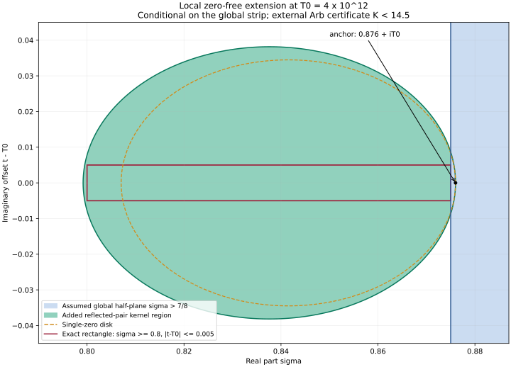

# RH-Zero-Free-Formalization

Research papers and Lean formalization for explicit zero-free boundaries
and local zero-free shapes.
Author of this formalization: **Li Xiang / lixiang90**.

The current uniform boundary is
$$
\sigma_* = \frac{11}{12}-\frac{e_*}{4}
          =0.874957019420098946\ldots,
\qquad 657e_*^3-954e_*^2+21e_*+20=0,
$$
with the unique root strictly isolated by
$$
\frac{16683858898627}{10^{14}}<e_*<
\frac{16683858898628}{10^{14}}.
$$

**Proof status:** the exact boundary, continuous algebraic certificate,
parameter feedback, ordered height closure and the concrete zeta inverse
Mellin signal are formalized. The separate arithmetic development now checks the complete low-kappa energy
induction, terminal certificate, finite-row energy bridges, slot construction,
moving parameters and local Euler corrections. The complete physical probe and its
low/raw-high estimates remain open. The sharpest zeta theorem
has an explicit `ZetaInverse.ArithmeticProbeObligation` hypothesis;
an unconditional Lean proof of the improved zero-free region is still pending.

The [main paper](papers/kappa-feedback-cubic-boundary-paper.pdf) derives the
strict half-plane Re(s) > sigmaStar for finite-order Hecke functions over
Q(sqrt(-3)), followed by Dirichlet functions and zeta, **relative to its stated
imported analytic package**. Principal poles are allowed and the boundary
line is excluded. The new code preserves those distinctions.

## Local shape extension

The new [local shape paper](papers/local-zero-free-shape-paper.pdf)
([TeX source](papers/local-zero-free-shape-paper.tex)) uses positive terms in
the completed zeta logarithmic derivative and same-height reflected zero
pairs to construct a quartic zero-free region. Assuming every nontrivial
zeta zero has real part at most `7/8`, an external Arb interval certificate
at `219/250 + 4000000000000 i` gives the closed local window

$$
\zeta(\sigma+it)\ne0\qquad
\left(\sigma\ge\frac45,\quad
\left|t-4000000000000\right|\le\frac1{200}\right).
$$

The conjugate negative-height window also follows. This extends the shape
locally; the uniform boundary above is unchanged.
[LocalShape](ZeroFree/LocalShape.lean) kernel-checks the finite real algebra
and conditional exclusions, including the entire real rectangle.
It uses an abstract zero predicate and explicit analytic hypotheses.
The global strip, Hadamard identity and Arb numeric bound are not thereby
proved in Lean. [Verification](verification/local-shape-lean.json),
[external interval certificate](verification/local-shape-arb.json) and
[scope/reproduction guide](docs/local-shape.md) record these separate layers.



Blue: the assumed zero-free half-plane `sigma > 7/8`. Green: the additional
reflected-pair quartic region. Red: the exact closed rectangle reaching
`sigma = 0.8` for `abs(t - 4e12) <= 0.005`. The vertical coordinate is the
offset from `T0 = 4e12`. White gaps are not certified. The global bound and
external Arb upper bound remain inputs; the plot is an illustration of the
exact algebraic certificate.

Recompute the external certificate and optional plot with Python 3.10+:

```sh
python -m pip install python-flint==0.9.0
python scripts/local_shape_certificate.py
# Optional figure: python -m pip install matplotlib numpy
python scripts/local_shape_certificate.py --plot
```

## What the kernel checks

| Module | Content |
|---|---|
| [Boundary](ZeroFree/Boundary.lean) | Root existence by the intermediate value theorem, uniqueness, strict rational isolation, and exact improvement over 7/8, 69999/80000 and the free-b boundary. |
| [Certificate](ZeroFree/Certificate.lean) | Every coefficient identity modulo the cubic, positive coefficients in the real embedding, square completion, and the continuous reference inequality. |
| [Geometry](ZeroFree/Geometry.lean) | Positive margins and ring identities for physical ranges, Gram gaps, slot supply, Euler boxes and the auxiliary buffer. |
| [Feedback](ZeroFree/Feedback.lean) | Exact finite count differences, their bound by a parameter increment divided by 50, the derived physical slope, and the 359 Delta/400 strict saving. |
| [Continuation](ZeroFree/Continuation.lean) | Actual Mellin convergence, analyticity, the identity theorem and nonvanishing; ported from OpenAI/math with provenance. |
| [Signal](ZeroFree/Signal.lean) | Variable-boundary low/high signal combination and conditional specialization to Mathlib's actual riemannZeta. |
| [Family](ZeroFree/Family.lean) | A uniform-margin family contradiction without assuming the zero supremum is attained. |
| [HeightClosure](ZeroFree/HeightClosure.lean) | Choose the height exponent before the tail order, collapse raw high estimates, and retain a family-wide positive saving. |
| [ZetaConcrete](ZeroFree/ZetaConcrete.lean) | Prove boundedness of actual zeta zero real parts and entire pole removal with the proved residue at one. |
| [ZetaInverse](ZeroFree/ZetaInverse.lean) | Construct the actual Gaussian inverse Mellin signal; prove the reciprocal bound, local integrability and arbitrary power decay at zero. |
| [ZetaSignal](ZeroFree/ZetaSignal.lean) | Derive the Mellin product identity and reduce the zeta theorem to arithmetic correction/probe estimates. |
| [PlainComparison](ZeroFree/PlainComparison.lean) | Check repaired scalar reflected/clipping budgets at kappa >= 37/50; the separate arithmetic capsule also checks the actual terminal induction. |
| [SourceScaling](ZeroFree/SourceScaling.lean) | Normalize the actual complex powers at variable slot length and scale imbalance; match the paper exponent and the constructed zeta amplitude while preserving the intrinsic Mellin pole 1/6. |
| [Main](ZeroFree/Main.lean) | Connection of the cubic certificate to the rational count, buffer admission, and the explicitly conditional best-boundary zeta theorem. |
| [LocalShape](ZeroFree/LocalShape.lean) | Reflected-pair quartic identity, exact corner values, positivity on the entire real rectangle, conditional shape/rectangle/disk exclusions and finite nonnegative weighted-anchor exclusion. |

Lean proves every coefficient identity and real inequality using ordinary
kernel-checked proofs. The historical Python audit is outside the proof trust
boundary. The continuous assertion covers every y >= 0 and every real delta
in the cleared quadratic; the endpoint conclusion uses its stated rectangle.

An axiom audit of a conditional theorem checks the implication with its
hypotheses. It does not prove those hypotheses. The open input and
paper-to-code mapping are in [proof-status.md](docs/proof-status.md).

## Reproduce the verification

- Lean: `leanprover/lean4:v4.33.0-rc2`
- Mathlib: `51e6992efd06126df61a496bebf8f49482a4e129`
- All dependency revisions: [lake-manifest.json](lake-manifest.json)

From a fresh checkout with Elan and Python 3.10+:

```sh
lake update
lake exe cache get
python scripts/verify.py
```

The script builds the entire library and freshly prints the transitive axioms
of every public theorem. It rejects placeholders, custom axioms and unchecked
computational proof methods. Permitted foundational axioms are
`propext`, `Quot.sound`, and `Classical.choice`.

Before the local shape addition, the complete library build and fresh audit
of **224 public theorems passed**,
with only the three foundational axioms above. Source-bound results and logs
are in [lean-verification.json](verification/lean-verification.json).
A fresh **serial independent Nano replay passed 58,126 declarations** from all
224 public roots. Commands, input hashes and permitted-axiom output are in
[independent-kernel.json](verification/independent-kernel.json).
Both checks retain the explicit analytic hypotheses described above.
With the local shape addition, a fresh compilation of all **19 library
modules** and a fresh transitive axiom audit of all **246 public theorems
passed**. The [integration record](verification/local-shape-integration.json)
contains the source hashes, commands and complete root list; its
[build log](verification/local-shape-integration-build.log) and
[axiom log](verification/local-shape-integration-axioms.log) accompany it.
This check used the pinned Lean compiler directly with read-only Mathlib
dependencies. It preserves every explicit analytic hypothesis.
Those historical records do not certify the added module. Its fresh
Lean verification is recorded separately in
[local-shape-lean.json](verification/local-shape-lean.json);
`scripts/verify.py` now includes `LocalShape` in future full-library audits.
No independent Nano replay of the added module is claimed here.
Tool setup and local cache details: [reproduction.md](docs/reproduction.md).

## Papers and sources

The [papers directory](papers/README.md) contains the new local shape paper
and byte-identical historical TeX/PDF copies of the cubic paper and its two
predecessors. Historical delivery hashes are retained in
[paper-provenance.json](verification/paper-provenance.json); the new paper
has its own [manifest](verification/local-shape-paper.json).

New zero-free-region research and formalization are maintained in this
repository and are no longer synchronized to
[RH-Weil](https://github.com/lixiang90/RH-Weil), which focuses on the general
Riemann hypothesis. Earlier transferred papers keep their historical
provenance. The separate
[zero-proportion formalization](https://github.com/lixiang90/RH-Zero-Proportion-Formalization)
concerns critical-line proportions.

The paper cites OpenAI/math revision `adc7f124...`; generic analytic modules
were ported from the separately inspected revision `fd4aeeb2...`.
Exact hashes, modifications, licenses and scope are in the
[upstream audit](docs/upstream-audit.md). The full upstream seven-eighths
proof was inspected statically; this repository has not compiled or
kernel-certified that complete proof. The actual low-kappa source extension
is compiled separately with its original toolchain; its current proof status
and repaired margins are described in [plain-kappa-extension.md](docs/plain-kappa-extension.md).
The [arithmetic capsule](upstream/plain-kappa/README.md) separately records
actual Lean 4.34.1 compilation, fresh complete types/axioms and independent
replays for all **99 selected roots in 34 authored modules**: slot construction,
moving parameters, Euler correction, principal comparison/normalization,
Gram-factor scales, the ray-prime normalizer, conditional Dirichlet/zeta
transfer, actual finite-row energy interfaces, arbitrary-total source Batch
construction, the finite-fiber height-loss budget, actual moving-kappa marked
admission and a universal marked bound for every matching source Batch and
nonempty fiber. For a fixed prime set and its product ideal, scalar losses
precede the mesh and slots; terminal/profile degrees and a common positive
height ceiling precede all outer characters. Each character's constant and
scale threshold precede every admitted smaller height exponent and Batch.
The unmarked admission additionally covers max(1,2m), retaining its actual
PositiveAt, enlarged state-width and polynomial-scale caps.
A separate four-root replay checks the complete patched low-kappa induction
and its terminal output. The source-after-slots interface now constructs
scalar losses and physical slots before any later positive detector e, then
chooses a genuine FirstTail-compatible excluded prime set and nonzero product
ideal. Degrees and the common height are subsequently fixed before outer
characters. The full HighData budgets, remaining Moments fields, counts and
physical probe remain open. See the [source-order status](docs/source-assembly-order-audit/README.md).
The [finite-row integration note](docs/finite-row-energy-integration.zh.md)
explains the constructed NaturalState, exact fiber dictionary and height budget.
The imported PNTA source contains two original placeholders; neither occurs
in the selected exports. This separate scope is not added to the primary
224-theorem count.

Code is distributed under Apache-2.0. Archived paper authorship and
publication status are preserved.
